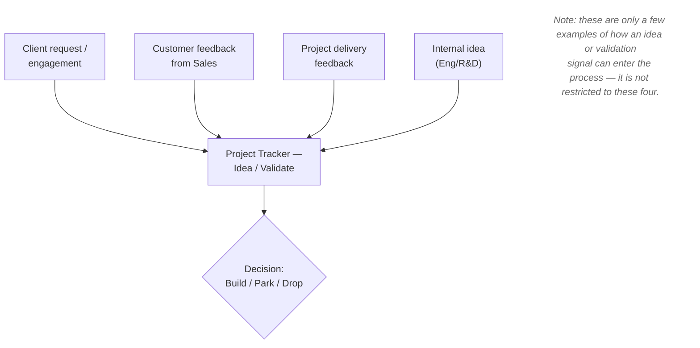
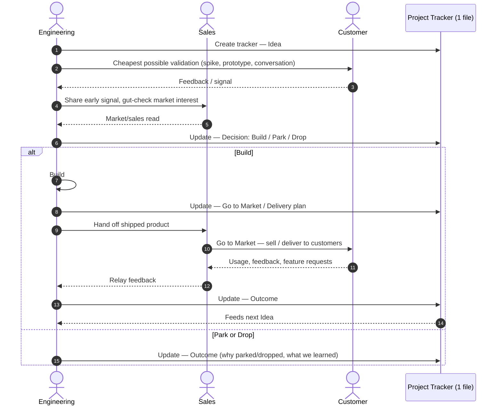

# Project Process (Simplified for a Small Team)

How a project moves from "someone has a hunch" (or a client asks for something) through validation, build, and
delivery, with what we learn feeding the next one. Every project in this repo follows this process and lives in its
own numbered folder under `project/`.

## The shape

Five stages a project moves through. They're a mental model, not a bureaucracy — a project can move through all
five in an afternoon or over a quarter, and it's fine to skip straight to "Build" for obvious small stuff.

1. **Idea** — someone notices a problem worth solving, an opportunity worth chasing, or a client brings a request.
   This can come in from several different channels — see "Where ideas and validation come from" below.
2. **Validate** — cheapest possible way to find out if it's worth building (a prototype, a conversation with the
   client, a spike). Ends in a one-line decision: build it, park it, or drop it.
3. **Build** — how we intend to actually build it: the engineering work itself.
4. **Go to Market / Deliver** — how it reaches the people it's for: pricing, positioning, client handover, who
   sells or delivers it and how.
5. **Learn** — after it's out, did it work? What did we learn? Feeds the next idea.

### Where ideas and validation come from

The Idea and Validate stages don't have one fixed entry point — a project can be kicked off or gut-checked from
several different directions before it ever reaches the Build/Park/Drop decision. A few of the more common
channels:



Whichever channel a project enters through, it still funnels into the same single tracker file and the same
Build/Park/Drop decision below — the multiple entry points are about *where the signal comes from*, not a
different process once it's in flight.



Three actors — Engineering, Sales, Customer — cover the roles that actually exist day to day. In a small team the
same person may sit in more than one of these roles; the diagram still shows the interaction, it just collapses to
that person talking to themselves when Engineering and Sales are the same head. The specific
"Eng ↔ Cust ↔ Sales" flow shown is one common path through the channels above — not the only one.

## The only artifact: one tracker file per project

Instead of separate documents per stage (pitch deck, feasibility assessment, handoff package, launch report,
budget tracker), use **one file that travels with the project and gets updated in place** as it moves through the
five stages above.

Template: [`templates/project-tracker-template.md`](templates/project-tracker-template.md).

Guidelines:
- Create it when an idea is worth more than a chat message (i.e. you're about to spend real time on it).
- Update it in place — don't create a new doc per stage. History lives in git, not in a document trail.
- Keep every section to a few lines. If a section is trying to grow into its own document, that's a signal the
  project itself has gotten big enough to warrant more process — not that every project needs it by default.
- Skip sections that don't apply (e.g. no budget worth tracking for a two-day spike — just say so).
- Supporting docs (designs, meeting notes, proposals) go in the same project folder alongside the tracker.

## When to add more process back in

This lightweight version assumes small headcount, short feedback loops, and informal trust between whoever's
wearing each hat. Signals it's time to add a formal gate, a separate handoff doc, or real budget tracking:

- A project's cost/headcount is big enough that a casual "yeah let's build it" decision creates real risk.
- Engineering and the people validating ideas are different people who don't talk daily, so an implicit handoff
  loses information.
- There are enough concurrent projects that the project list in the root `README.md` isn't enough to see the
  whole portfolio at a glance.

Until then, prefer the tracker template over reintroducing a multi-document process.

## Tooling

- **GitHub (this repo)** — the system of record for projects. Each project gets its own numbered folder under
  `project/` (see the root [`CLAUDE.md`](../../CLAUDE.md) "Projects" section), holding that project's tracker file
  and any supporting docs, tracked and versioned like everything else in this repo.
- **Time tracking** — if engineer hours are logged in an external tool, that tool is the source of truth. Link to
  it from the tracker and progress report rather than re-entering or estimating hours here.

## Reporting progress

For a project that's been running a while, use
[`templates/progress-report-template.md`](templates/progress-report-template.md) to produce a periodic snapshot
(e.g. monthly, or whenever a stakeholder asks "where's this at"). It's separate from the tracker file: the tracker
is the living record you edit in place; the progress report is a point-in-time summary you can hand to someone who
doesn't want to read the whole tracker. Save reports in the project folder as `progress-report-YYYY-MM-DD.md`.

## Prompts

Copy-paste starting points for an agent (Claude or otherwise) in this repo. Fill in the bracketed parts. In Claude
Code the same flows are available as the `/new-project` and `/progress-report` skills.

### Kick off a new project

```
Start a new project in this repo: [one or two sentences on the idea/opportunity/client request, and where
the signal came from — e.g. client engagement, customer feedback via Sales, project delivery feedback, or
an internal idea].

Follow the "Projects" section of CLAUDE.md:
1. Read project/00 - Project Process/README.md for the process.
2. Create a new numbered folder under project/ (next available number).
3. Copy templates/project-tracker-template.md into it as README.md and fill in the Idea section.
4. Update the root README.md with a new row for this project per the Storage mode steps.

Don't fill in Validation, Decision, Build, or Go to Market yet — just get the Idea section and the
project scaffolding in place.
```

### Generate a progress report for an existing project

```
Produce a progress report for the project in project/[NN - Project Name]/.

Follow the "Projects" section of CLAUDE.md: use
project/00 - Project Process/templates/progress-report-template.md — do not edit the tracker file's
history. Read the project's existing tracker for current status and context. For engineer hours/cost,
link the time-tracking source rather than estimating or re-deriving hours.

Reporting period: [e.g. "since last report" or "for September 2026"].
```
